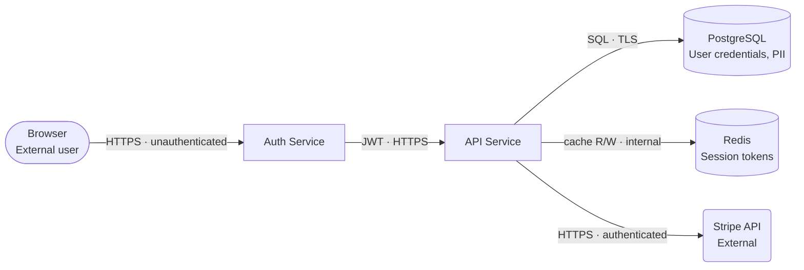
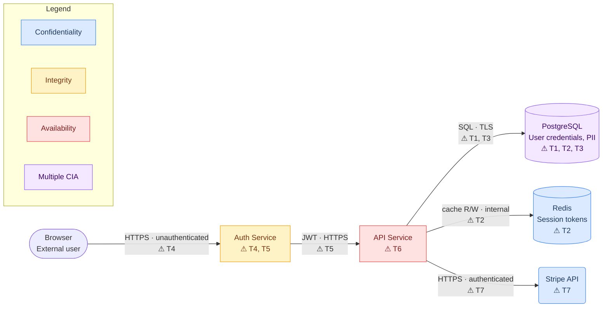

# threat-modeling: data flow diagram

> **Re-read note:** If the Read tool reports "file unchanged", reload with
> `cat <skill-dir>/diagram.md` via Bash.

**Gate:** generate a diagram only if `diagram` was selected at the Step 0.7
kickoff (or in `--artifacts`). If it was not selected, never generate one —
not even as a helpful extra. Two follow-ups were asked at the kickoff; if
either answer is not recorded and the session is interactive, ask now;
non-interactive defaults in brackets:

- threat-ID overlay color-coded by CIA, yes or no? [on]
- format: `mermaid` (Part 1 only) or `both` (Part 1 + the Structurizr DSL
  workspace of Part 2)? [mermaid — never emit the DSL without the Mermaid
  fallback, and never emit only the DSL]

Output file: `<run-dir>/THREAT_MODEL_dataflow.md`.

**Part 1** is everything from "Diagram structure" through "Verify before
providing" — the Mermaid renderer, always generated. **Part 2** (the
Structurizr DSL workspace) is appended below and runs only for
`format: both`.

---

## Diagram structure

Use `flowchart LR` (left-to-right) by default. Switch to `flowchart TD`
(top-down) only if the system has clearly distinct horizontal tiers (e.g.
browser → load balancer → app cluster → database tier).

Every Section 2 asset must appear as a node. Every Section 3b data flow must appear as a
directed edge.

### Node shapes

| Entity type | Mermaid syntax | Use for |
|---|---|---|
| External user / actor | `(["label"])` | End users, external clients |
| Internal service / process | `["label"]` | APIs, workers, auth services |
| Data store | `[("label")]` | Databases, caches, object storage, files |
| External system / third-party | `("label")` | External APIs, SaaS, cloud providers |

Multi-line node labels: use `<br/>` inside the quoted string — never `\n`,
which renders as literal backslash-n on GitHub, the main place this file is
viewed. Entity name on line 1, a short description (asset type or key data
held) on line 2.

```
DB[("PostgreSQL<br/>User credentials, PII")]
Cache[("Redis<br/>Session tokens")]
User(["Browser<br/>External user"])
```

### Clean, straight layout (the diagram must read at a glance)

- **Declare nodes in flow order** (left edge of the system first, data stores
  last) and group each tier in a `subgraph` when there are more than ~8 nodes
  — Mermaid lays out what you declare in order; declaration order is your
  layout tool.
- One edge per Section 3b flow — never duplicate an edge to say two things;
  fold both into one label.
- Edge labels stay short (≤ 6 words + threat ids); long detail belongs in the
  tables, not the picture.
- Node ids: short alphanumeric (`API`, `DB`, `RS1`), never starting with a
  digit, never a Mermaid reserved word (`end`, `graph`, `class`, `click`,
  `style`, `subgraph`, `direction`); quote every label that contains
  spaces or punctuation.
- Declare `flowchart LR` (or `TD`) exactly once, first line.

### Edge labels

Label every edge. Include what the flow carries and its auth/encryption
status. Use `·` to separate attributes.

```
User -->|"HTTPS · authenticated"| Auth
API -->|"SQL · TLS · service account"| DB
API -->|"cache read/write · unauthenticated"| Cache
```

If a flow is **unauthenticated** or **unencrypted**, say so explicitly —
these are threat signals and should be visible in the diagram.

---

## Without threat overlay

Generate the basic diagram with all assets as nodes and all flows as edges.
No color coding, no threat annotations.



---

## With threat overlay

Add Section 4 threat IDs to nodes and edges. Color-code nodes by the CIA dimensions
of the threats attached to them (use each threat's `cia` tag from the Section 4
table).

### CIA color classes (always include these four classDef lines)

```
classDef conf fill:#dbeafe,stroke:#3b82f6,color:#1e3a5f
classDef integ fill:#fef3c7,stroke:#f59e0b,color:#78350f
classDef avail fill:#fee2e2,stroke:#ef4444,color:#7f1d1d
classDef mixed fill:#f3e8ff,stroke:#8b5cf6,color:#3b0764
```

### Placing threat IDs

**On nodes:** append a line `⚠ T1, T3` to the node's label for each threat
whose primary asset is that node.

**On edges:** append `· ⚠ T2` to the edge label for each threat that
exploits or affects that specific data flow (e.g. a Confidentiality threat
on an unencrypted channel, an Integrity threat on a write path).

A threat may appear on both a node and an edge if both are relevant.

```
DB[("PostgreSQL<br/>User credentials, PII<br/>⚠ T1, T2, T3")]
API -->|"SQL · TLS<br/>⚠ T1, T3"| DB
```

### Assigning color classes

For each node, look at the union of `cia` tags across the threats annotated
on it:

| Threats on this node | Apply class |
|---|---|
| Confidentiality only | `conf` |
| Integrity only | `integ` |
| Availability only | `avail` |
| Two or more CIA dimensions | `mixed` |
| No threats | _(no class — default white)_ |

Apply with `class NodeId className` after all node/edge definitions.

### Legend subgraph (always include when overlay is on)

```
subgraph Legend["Legend"]
  direction LR
  LC["Confidentiality"]:::conf
  LI["Integrity"]:::integ
  LA["Availability"]:::avail
  LM["Multiple CIA"]:::mixed
end
```

### Full example with overlay



---

## Output file: THREAT_MODEL_dataflow.md

Write a markdown file with a short header and the Mermaid code block.

```markdown
# Data Flow Diagram: <system name>

Generated: <YYYY-MM-DD>
Threat overlay: <yes — threat IDs annotated, color-coded by CIA dimension | no>

> Render this diagram in any Mermaid-compatible viewer: GitHub markdown,
> VS Code Mermaid Preview extension, or mermaid.live

\`\`\`mermaid
<diagram code here>
\`\`\`

## Threat ID reference

<If overlay is on: a compact table mapping threat IDs to one-line
descriptions, so the reader can look up a threat from the diagram without
opening THREAT_MODEL.md>

| ID | STRIDE | CIA | Asset | Threat |
|---|---|---|---|---|
| T1 | I | C | User credentials | ... |
```

If overlay is off, omit the threat ID reference table.

## Verify before providing (mandatory — a broken diagram is worse than none)

Run both checks on the finished Mermaid block, fix failures, and only then
write the file:

**1. Consistency lint:** every node maps to a Section 2 asset (or an external
actor), every edge to a Section 3b flow, and every `⚠` id exists in
Section 4. A diagram that shows an asset or flow the tables don't have means
the tables are incomplete — fix them first.

**2. Syntax & render lint** (re-read the emitted block line by line —
Mermaid fails closed, so one error blanks the whole diagram on GitHub):

- First line is exactly one `flowchart LR` or `flowchart TD`.
- Every edge's two endpoints are node ids declared in this block; ids are
  unique, alphanumeric, don't start with a digit, and none is a reserved
  word (`end`, `graph`, `class`, `click`, `style`, `subgraph`, `direction`).
- Bracket pairs match the shape table exactly: `([" "])`, `[" "]`,
  `[(" ")]`, `(" ")` — count opens equal closes on every line.
- Every label containing a space, `(`, `)`, `/`, `·`, or `⚠` is inside
  double quotes; line breaks in labels are `<br/>` only (a literal `\n`
  fails this lint).
- Every `class X y` and `:::y` references a declared node and one of the
  four classDef names; the classDef lines are present when overlay is on;
  every `subgraph` has a matching `end`.
- **Single spaces inside `class` and `classDef` statements — no
  column-alignment padding.** GitHub's parser hard-fails on
  `class DB    mixed` (this exact error shipped once: "Expecting
  'NODE_STRING'… got 'SPACE'"). Write `class DB mixed`.
- Every `subgraph` carries a real quoted title (`subgraph Legend["Legend"]`)
  — not an empty or whitespace-only one.
- No duplicate edges for the same Section 3b flow; edge count equals the
  Section 3b row count.

If any check cannot be made to pass, ship the diagram without the failing
element and record the omission in the output file's header line — never
ship a block that may fail to render.

---

## Part 2 — C4 / Structurizr option (`format: both`)

Emit a C4 model alongside (never instead of) the Mermaid diagram. Both
renderers MUST be generated from one intermediate file so they can never
drift apart.

### 2.0 Landscape facts (verified 2026-09; re-verify before relying on them)

- Tooling is consolidated into `github.com/structurizr/structurizr`
  (Apache 2.0), docker image `structurizr/structurizr` — **pin the image
  tag** (e.g. `2026.06.28`). The old `structurizr/cli` and `structurizr/lite`
  images and the structurizr.com cloud service are EOL — never build on
  them.
- GitHub renders **neither** Structurizr DSL **nor** Mermaid's experimental
  `C4Context`/`C4Container` syntax. Never use Mermaid-C4 anywhere.
- `structurizr export --format mermaid` output breaks on GitHub (HTML
  `<div>` labels and `click` lines require `securityLevel: loose`, which
  GitHub cannot set). Never route the GitHub-facing diagram through the
  exporter — Part 1's hand-emitted Mermaid is the GitHub artifact.
- The only paid piece is `structurizr server` (multi-user hosted viewer);
  `local`, `export`, `validate`, and `inspect` are free.

### 2.1 Intermediate model: `threat-model.json`

Write this first, into the run dir, derived from the emitted Sections
2/3b/4 (post-review — same sourcing rule as the CSVs):

```json
{
  "elements":      [{"id": "", "name": "", "kind": "person|process|datastore|external",
                     "zone": "", "technology": "",
                     "properties": {"threats": [], "cia": []},
                     "url": "THREAT_MODEL.md#anchor"}],
  "relationships": [{"from": "", "to": "", "description": "", "technology": "",
                     "crossesBoundary": true, "flowId": "", "threats": []}],
  "zones":         [{"id": "", "name": "", "trust": "untrusted|dmz|internal|data"}],
  "scenarios":     [{"name": "", "steps": ["relationship ids in order"]}]
}
```

Part 1's Mermaid block and Part 2's DSL are both pure renderings of this
file. The consistency lint checks the JSON against the tables once; the
renderers inherit that correctness.

### 2.2 `workspace.dsl` generation rules

Output file: `<run-dir>/workspace.dsl` (plain text; template it directly —
no library needed).

- One `softwareSystem` for the target; each JSON element becomes a
  `container` (or `person` for actor kinds, `softwareSystem` for externals);
  each zone becomes `group "<name>"` plus a `Zone:<name>` tag on members.
- Threat metadata goes THREE places (exports drop most of them, so the
  redundancy is deliberate): `properties { "threats" "T1,T9" }`; a
  `perspective "Security"` whose value is the element's highest residual
  band; and the threat ids kept in the element description text so they
  survive every exporter.
- Styling: `element "Zone:Untrusted" { background #d64545 color #ffffff }`
  per zone; `relationship "CrossesBoundary" { color #d64545 style dashed }`;
  optionally `element "Perspective:Security[value==High]" { stroke red }`
  (renders in the Structurizr UI only).
- Views: `systemContext` + `container` always; one `dynamic` view per
  Section 4b chain (steps from `scenarios`); one `deployment` view per
  environment **when the run had infra research** — nested `deploymentNode`s
  are the honest trust boundaries. `autoLayout lr` everywhere.
- Docs-as-code when the model lives in the target repo: `!docs` at the
  directory holding THREAT_MODEL.md and `!adrs adr/` (adr-tools/MADR) for
  accepted-risk decisions; element `url` deep-links to Section anchors.
- Detail level: the DSL follows the run's `detail` level exactly like the
  model (SKILL.md Step 0.55). At `detail: public`, build it from
  public-class cells only — class-(c) infra facts (cluster names, internal
  hostnames) are generalized; at `detail: full` they may appear, since the
  DSL goes into the same private/internal repo as the model.

### 2.3 Verify before providing (DSL)

Lint the workspace by hand — this is the skill's verification path (its
allowed tools do not include docker): every relationship endpoint is a
declared identifier; every `dynamic` step references a declared
relationship; every tag used in `styles` is assigned somewhere;
`!docs`/`!adrs` paths exist relative to the DSL file. A workspace that
fails the lint ships without the failing element, noted in the file
header — same rule as Part 1. Optional human step: a reviewer with docker
can additionally run `structurizr validate --workspace workspace.dsl`
(pinned tag) before committing the DSL anywhere.

### 2.4 Consumption notes (put a short version in the output file header)

- Author/view locally:
  `docker run -it --rm -p 8080:8080 -v "$PWD":/usr/local/structurizr structurizr/structurizr:<pinned> local`
- CI render for sharing: `... export --workspace workspace.dsl --format
  static` (self-contained HTML site, fits GitHub Pages), or `--format
  plantuml` piped to plantuml.jar for committed PNG/SVGs. Do not commit
  `export --format mermaid` output into GitHub-rendered Markdown (see 2.0).

